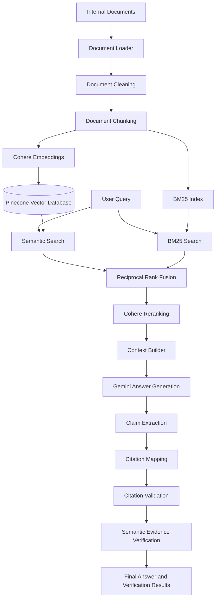

# Hybrid Search RAG over Internal Documents

A Retrieval-Augmented Generation (RAG) system that combines semantic search, keyword-based retrieval, Reciprocal Rank Fusion (RRF), and neural reranking to answer questions from internal documents.

The system uses Google Gemini for answer generation and claim-level semantic verification, with citation validation to improve answer traceability and reduce unsupported responses.

## Project Overview

Traditional RAG systems often rely on a single retrieval strategy. This can miss relevant information when users phrase queries differently from the wording in the source documents.

This project implements a **Hybrid Search RAG architecture** that combines:

- Semantic retrieval using Cohere embeddings and Pinecone.
- Keyword retrieval using BM25.
- Reciprocal Rank Fusion (RRF) to combine retrieval results.
- Cohere Rerank to improve the relevance of retrieved chunks.
- Google Gemini for context-based answer generation.
- Claim-level citation mapping and semantic verification.
- Explicit abstention when sufficient evidence is unavailable.

The goal is to provide answers grounded in retrieved documents, with traceable citations and verification results for individual claims.

## Key Features

1. **Multi-format Document Processing:** Extracts text from PDF, DOCX, and TXT documents.
2. **Document Cleaning:** Normalizes extracted text while preserving meaningful paragraph and line boundaries.
3. **Intelligent Chunking:** Splits documents into overlapping chunks while preserving source metadata and document references.
4. **Semantic Search:** Generates embeddings using Cohere Embed (`embed-v4.0`) and retrieves relevant chunks from Pinecone.
5. **Keyword Search:** Uses BM25 to identify relevant documents based on keyword matching.
6. **Hybrid Retrieval:** Combines semantic and keyword search using Reciprocal Rank Fusion.
7. **Neural Reranking:** Uses Cohere Rerank (`rerank-v3.5`) to refine the retrieved results.
8. **Context-Aware Generation:** Uses Google Gemini to generate answers based on retrieved document context.
9. **Claim-Level Citation Verification:** Maps individual answer claims to retrieved evidence and validates their citations.
10. **Semantic Evidence Verification:** Uses Gemini to classify claims as supported, contradicted, or insufficiently supported.
11. **Evidence-Based Abstention:** Avoids generating an answer when retrieval provides no evidence or the model identifies insufficient evidence.
12. **REST API:** Exposes the RAG pipeline through FastAPI.
13. **Evaluation and Testing:** Includes retrieval metrics, answerability evaluation, and automated tests.

## System Architecture



### Retrieval Pipeline

**1. Semantic Retrieval**

- Document chunks are converted into vector embeddings using Cohere Embed.
- Embeddings are stored in Pinecone.
- User queries are embedded using the query-specific input type.
- Pinecone retrieves semantically relevant chunks.

**2. Keyword Retrieval**

- BM25 builds a keyword-based index over document chunks.
- User queries are matched against the indexed document text.
- Relevant chunks are ranked based on lexical relevance.

**3. Reciprocal Rank Fusion**

The results from semantic and keyword retrieval are combined using RRF.

The fusion score is calculated as:

\[
RRF(d)=\sum_{r \in R}\frac{1}{k+rank_r(d)}
\]

Where:

- \(d\) represents a retrieved document chunk.
- \(R\) represents the retrieval result lists.
- \(rank_r(d)\) represents the rank of the chunk in a result list.
- \(k\) is a constant set to 60.

**4. Reranking**

Cohere Rerank evaluates the relevance of the fused chunks against the original query and selects the final top-ranked results.

### Generation and Verification Pipeline

**1. Answer Generation**

Retrieved chunks are assembled into context and passed to Google Gemini along with the user's question.

**2. Claim Extraction**

The generated answer is divided into individual claims, with evidence references extracted from the answer.

**3. Citation Mapping**

Each evidence reference is mapped to its corresponding retrieved chunk using metadata such as:

- Chunk ID
- Document ID
- Source filename
- Page number

**4. Citation Validation**

The system checks whether the referenced evidence exists and matches the retrieved source metadata.

**5. Semantic Evidence Verification**

Gemini evaluates whether the mapped evidence supports the corresponding claim.

The verification process handles three semantic verdicts:

- `SUPPORTED`
- `CONTRADICTED`
- `INSUFFICIENT_EVIDENCE`

**6. Final Answer Construction**

The system combines citation validation and semantic verification results to produce the final response.

If retrieval returns no evidence, the pipeline abstains without calling Gemini for answer generation.

## Technology Stack

| Component | Technology |
|---|---|
| Programming Language | Python |
| Backend Framework | FastAPI |
| LLM / Answer Generation | Google Gemini API |
| Embedding Model | Cohere Embed (`embed-v4.0`) |
| Vector Database | Pinecone |
| Keyword Retrieval | BM25 (`rank_bm25`) |
| Hybrid Retrieval | Reciprocal Rank Fusion |
| Reranking | Cohere Rerank (`rerank-v3.5`) |
| Data Validation | Pydantic |
| Document Processing | PyMuPDF, python-docx |
| Testing | Pytest |

## Project Structure

```text

hybrid-search-rag/
|
+-- api/
|   +-- main.py
|   +-- routes.py
|   +-- schemas.py
|
+-- config/
|
+-- data/
|   +-- raw_documents/
|   +-- processed/
|   +-- sample_documents/
|
+-- evaluation/
|   +-- answerability_runner.py
|   +-- evaluation_runner.py
|   +-- retrieval_metrics.py
|   +-- smoke_test_dataset.json
|
+-- generation/
|   +-- answer_pipeline.py
|   +-- context_builder.py
|   +-- prompt_templates.py
|   +-- gemini_client.py
|   +-- verification/
|       +-- claim_extractor.py
|       +-- citation_mapper.py
|       +-- citation_validator.py
|       +-- evidence_verifier.py
|       +-- verification_engine.py
|       +-- final_answer.py
|
+-- ingestion/
|   +-- document_loader.py
|   +-- document_cleaner.py
|   +-- document_chunker.py
|   +-- embedding_generator.py
|   +-- vector_store.py
|
+-- retrieval/
|   +-- vector_search.py
|   +-- bm25_search.py
|   +-- reciprocal_rank_fusion.py
|   +-- reranker.py
|   +-- hybrid_search.py
|
+-- storage/
|   +-- bm25_index/
|
+-- tests/
|
+-- run.py
+-- requirements.txt
+-- .env.example
+-- .gitignore
+-- README.md

```

The repository also contains individual test modules at the project root.

## Installation and Setup

### Prerequisites

- Python 3.13.3
- Git.
- Google Gemini API key.
- Cohere API key.
- Pinecone API key.

### 1. Clone the Repository

```bash
git clone https://github.com/rushi1199-jagtap/hybrid-search-rag.git
```

```bash
cd hybrid-search-rag
```

### 2. Create a Virtual Environment

**Windows PowerShell:**

```powershell
python -m venv venv
```

Activate it:

```powershell
.\venv\Scripts\Activate.ps1
```

### 3. Install Dependencies

```bash
pip install -r requirements.txt
```

### 4. Configure Environment Variables

Create a `.env` file in the project root using `.env.example` as a template.

```env
GEMINI_API_KEY=YOUR_GEMINI_API_KEY
GEMINI_MODEL=gemini-3.5-flash-lite

COHERE_API_KEY=YOUR_COHERE_API_KEY
COHERE_EMBED_MODEL=embed-v4.0
EMBEDDING_DIMENSION=1024

PINECONE_API_KEY=YOUR_PINECONE_API_KEY
PINECONE_INDEX_NAME=hybrid-search-rag
PINECONE_CLOUD=aws
PINECONE_REGION=us-east-1

COHERE_RERANK_MODEL=rerank-v3.5
```

Obtain API credentials from:

- Google AI Studio: https://aistudio.google.com/
- Cohere: https://dashboard.cohere.com/
- Pinecone: https://app.pinecone.io/

**Important:** Never commit your actual `.env` file or expose API credentials publicly. The repository uses `.gitignore` to exclude sensitive environment files.

### 5. Configure Pinecone

Create or configure a Pinecone index using the following settings:

| Setting | Value |
|---|---|
| Index name | `hybrid-search-rag` |
| Dimension | `1024` |
| Metric | `cosine` |
| Cloud | `aws` |
| Region | `us-east-1` |

The vector store module can create the index if it does not already exist.

The BM25 index must also be populated with the corresponding document chunks before keyword retrieval can be used.

## Running the Application

Start the FastAPI application:

```bash
python run.py
```

The server runs at:

```text
http://127.0.0.1:8000
```

### API Documentation

FastAPI provides interactive Swagger documentation at:

```text
http://127.0.0.1:8000/docs
```

Alternative ReDoc documentation:

```text
http://127.0.0.1:8000/redoc
```

## API Usage

### Available Endpoints

| Method | Endpoint | Description |
|---|---|---|
| GET | `/` | API information |
| GET | `/health` | Health check |
| POST | `/api/v1/ask` | Submit a question to the RAG pipeline |

### Example Request

**Endpoint:**

```http
POST /api/v1/ask
```

**Request Body:**

```json
{
    "query": "What is deep learning?",
    "top_k": 5,
    "semantic_top_k": 10,
    "bm25_top_k": 10,
    "use_reranking": true
}
```

### Request Parameters

| Parameter | Default | Description |
|---|---:|---|
| `query` | Required | User's question |
| `top_k` | 5 | Number of final retrieved chunks |
| `semantic_top_k` | 10 | Number of semantic search results |
| `bm25_top_k` | 10 | Number of BM25 search results |
| `use_reranking` | true | Enable or disable Cohere reranking |

### Response Structure

The API response contains:

- `query`: Original user question.
- `answer`: Generated answer or abstention message.
- `citations`: Source evidence references.
- `insufficient_evidence`: Indicates whether the answer lacks sufficient evidence.
- `verification`: Claim-level verification summary.
- `retrieved_chunks`: Retrieved document chunks and relevance metadata.

Each claim verification result includes its status, citation validity, mapped evidence, and semantic verification information where available.

## Evaluation

The project includes retrieval evaluation and answerability evaluation.

### Retrieval Metrics

The following metrics are implemented:

1. Precision@K
2. Recall@K
3. Mean Reciprocal Rank (MRR)
4. Normalized Discounted Cumulative Gain (NDCG@K)

These metrics help evaluate how effectively the retrieval system ranks relevant document chunks.

### Answerability Evaluation

The answerability evaluation checks whether the system answers questions when relevant evidence is available and abstains when sufficient evidence is unavailable.

It tracks:

- True Positives (TP)
- True Negatives (TN)
- False Positives (FP)
- False Negatives (FN)

### Current Smoke-Test Results

The current smoke-test dataset contains:

- 2 answerable queries.
- 1 unanswerable query.
- 2 synthetic document chunks.

The latest answerability smoke test produced:

| Metric | Result |
|---|---:|
| True Positives | 2 |
| True Negatives | 1 |
| False Positives | 0 |
| False Negatives | 0 |
| Smoke-test accuracy | 100% |

**Evaluation limitation:** These results are from a very small synthetic smoke-test dataset. They demonstrate expected pipeline behavior on the tested cases, not general model accuracy or production-level reliability.

### Automated Testing

Run the test suite using:

```bash
pytest -v
```

Latest recorded test result:

```text
45 passed, 7 warnings
```

The warnings were related to a Pydantic deprecation inside the Cohere SDK.

Tests cover document processing, embeddings, vector storage, retrieval, reranking, API schemas, answer generation, citation mapping, citation validation, verification verdicts, abstention, and evaluation metrics.

## Current Limitations and Future Improvements

The project is an actively developed prototype. Current limitations include:

1. The current smoke-test corpus is very small and synthetic.
2. Retrieval and answerability evaluation need a larger, more representative dataset.
3. Semantic verification depends on an LLM and therefore cannot guarantee factual correctness.
4. Scanned or image-only PDFs require OCR, which is not currently implemented.
5. BM25 indexing and vector storage need to remain synchronized when documents are added or updated.
6. The project does not yet provide a dedicated user-facing frontend.

### Planned Improvements

- Expand the evaluation dataset using real internal documents.
- Improve verification reliability with stronger evidence-grounding checks.
- Add OCR support for scanned documents.
- Implement a more complete document ingestion and indexing workflow.
- Add document management and index synchronization.
- Develop a frontend for interactive document querying.
- Evaluate retrieval and verification performance on larger datasets.

## Project Objective

The objective is to explore how combining semantic retrieval, keyword search, reranking, and claim-level verification can improve the reliability and traceability of Retrieval-Augmented Generation systems over internal documents.

The project focuses not only on generating answers, but also on checking whether individual claims can be traced back to retrieved evidence.

## Author

**Rushikesh Jagtap**


---

*Built with Python, FastAPI, Google Gemini, Cohere, Pinecone, and Retrieval-Augmented Generation techniques.*